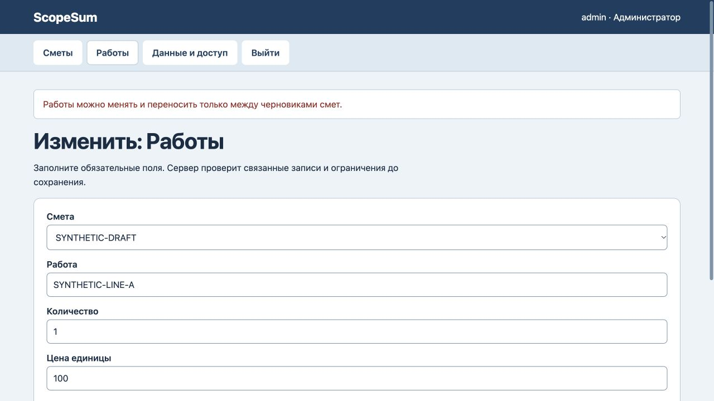

# ScopeSum: защита состава документов

24 октября2026. На прежнем коде воспроизведён обход: позиция переносилась из отправленной и принятой смет в другой черновик. Проверялся только статус назначения. В синтетическом примере исходный итог уменьшался с200 до100; это не данные клиента.

Теперь проверяется прежний исходный документ вместе с новым назначением. Если хотя бы один из них не черновик, строка должна остаться неизменной. Перенос между черновиками разрешён. Явный допустимый возврат документа в черновик сохраняет возможность редактирования; принятая смета неизменяема, а счёт с оплатой нельзя вернуть в черновик. Эти ограничения применяются в соответствующем продукте.

Все5 автоматических тестов прошли. Новая регрессия проверяет защищённые статусы, перенос с изменением цены и без него, прямую правку, архив, защищённое назначение, перезапуск файла базы, восстановление копии и сохранность данных при отказе. На старом коде регрессия падала с Missing expected exception.

В браузере попытка переноса отклонена. Оба итога200 и50, все сохранённые строки, версия6 и6 записей журнала остались прежними. После обновления страницы исходная привязка сохранена. [Машинная запись проверки](protected-lines-verification.json).

Исправлены предметное правило и формулировка отказа. Схема хранения и внешний вид не менялись. Сервер проверен локально; банковские операции, электронная подпись и клиентская приёмка не заявляются.
